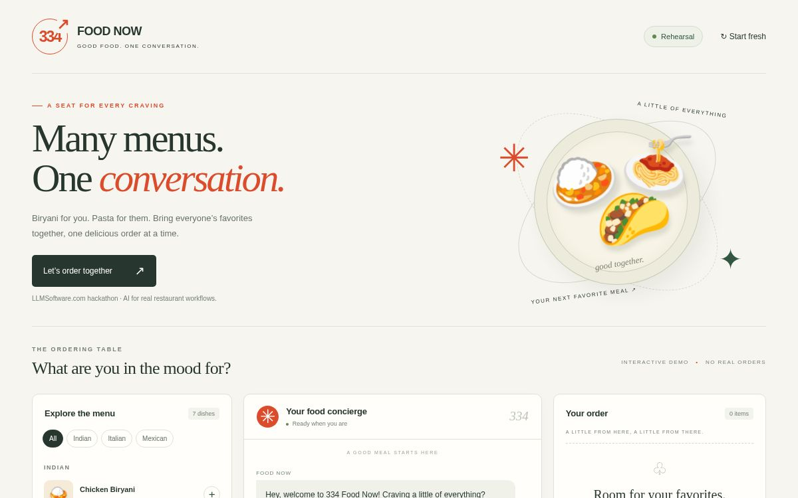
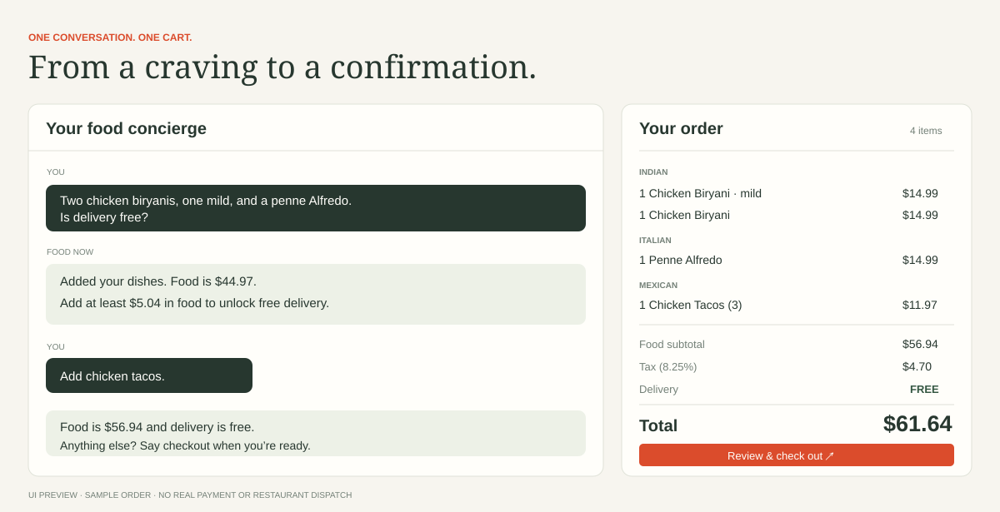

<div align="center">

# 334 Food Now

### Many menus. One conversation.

**A conversational restaurant-ordering prototype by Sanskriti Aripineni.**

[**Try the public demo ↗**](https://food-now-334-demo.rick-1354.chatgpt.site) · [Explore the UI](#a-look-inside) · [Run locally](#run-locally)

**Indian + Italian + Mexican · One cart · One checkout**

</div>

[](https://food-now-334-demo.rick-1354.chatgpt.site)

## The hackathon

This project grew out of my participation in the **[LLMSoftware.com](https://llmsoftware.com) hackathon**, focused on **“Hack AI that runs real restaurants.”** The idea: turn a natural conversation into a useful restaurant workflow—from menu discovery and a multi-restaurant order to checkout and a confirmation preview.

334 Food Now lets someone order biryani for one person, pasta for another, and tacos for the table without juggling separate carts.

## Try it in two minutes

**[Open the public demo](https://food-now-334-demo.rick-1354.chatgpt.site)** — no installation, API key, or sign-in needed.

1. Click **Try the sample order**: two chicken biryanis, one mild, plus a penne Alfredo.
2. Click **Add chicken tacos** to unlock free delivery.
3. Click **Review & check out**, then use the fictional name and address suggestions.
4. Confirm the demo order and download the receipt.

The hosted version is a **browser-only rehearsal**, using local menu matching rather than live Gemini. Each visitor has their own cart. Order details stay in that browser tab and clear on refresh. No real orders, texts, or payments are sent. The page itself is served by the hosting provider.

## A look inside

### One menu, one conversation, one receipt

[](https://food-now-334-demo.rick-1354.chatgpt.site)

*The opening image is a screenshot of the published demo. The walkthrough above is an illustrated sample conversation and receipt. Click either image to try the interface.*

| Explore | Converse | Check out |
| --- | --- | --- |
| Browse three cuisines and seven sample dishes. Filter by restaurant and add from the menu. | Ask about dishes, try the sample order, and watch the cart update. | Review item notes, tax, delivery, and a single total. Download a demo receipt. |

**The sample order:** $44.97 in food → add $11.97 chicken tacos → $56.94 food + $4.70 tax + free delivery = **$61.64**.

Delivery is $4.99 through a $50.00 food subtotal and free **over** $50.00. The interface also supports cart removal, reset, smaller screens, keyboard navigation, and reduced motion.

## Which link should I share?

| Link | Who can open it? |
| --- | --- |
| **[Public demo](https://food-now-334-demo.rick-1354.chatgpt.site)** | Anyone with the URL, including from an email. Your computer can be off. |
| `http://127.0.0.1:5055` | Only the computer running the local app. It is not a shareable internet address. |
| **[GitHub repository](https://github.com/SanskritiAripineni/Conversational_AI)** | Anyone can view the public source and this README. |

<details>
<summary><strong>Run locally</strong></summary>

Install [uv](https://docs.astral.sh/uv/getting-started/installation/), then run from the project folder:

```sh
uv venv --python 3.13
uv pip install -r requirements.txt
.venv/bin/python app.py web
```

Open **http://127.0.0.1:5055**. This local rehearsal uses the Python ordering engine and needs no API key.

To preview the exact public version locally:

```sh
python3 scripts/build_public_demo.py
python3 -m http.server 5056 --bind 127.0.0.1 --directory public-demo
```

Open **http://127.0.0.1:5056**. The checked-in `public-demo/` directory contains the portable static demo.

</details>

<details>
<summary><strong>Enable live Gemini or terminal chat</strong></summary>

```sh
cp .env.example .env
```

Create your own key in [Google AI Studio](https://aistudio.google.com/api-keys) and set `GEMINI_API_KEY` in your local `.env`.

```sh
# Browser with live Gemini interpretation
.venv/bin/python app.py web --live

# Original terminal demo
.venv/bin/python app.py chat
```

Live mode sends menu data, cart contents, and ordering conversation history to Google's Gemini API. Checkout details are handled locally. `GEMINI_MODEL` defaults to `gemini-2.5-flash`; adjust it for your account if needed.

The sample menu is included. A local `menus.json` overrides it, or set `MENU_FILE` to a menu path. Keep the filled-in `.env` local; never commit credentials or paste them into the demo chat.

</details>

<details>
<summary><strong>Run the Twilio phone demo</strong></summary>

1. Configure a Gemini key, a Twilio number, and a verified test caller.
2. Start an HTTPS tunnel to port 5055, for example `cloudflared tunnel --url http://127.0.0.1:5055`.
3. Set `PUBLIC_BASE_URL` to the tunnel origin, `TWILIO_AUTH_TOKEN` to your Twilio auth token, and `DEMO_SMS_TO` to the verified test phone in E.164 format in your local `.env`.
4. Run `.venv/bin/python app.py` without `web`. Set the Twilio inbound Voice webhook to **HTTP POST** at `PUBLIC_BASE_URL/voice`.
5. Call from the configured phone. Use fictional names and addresses.

Textbelt is optional. A `TEXTBELT_KEY` enables real confirmation texts only to the configured test phone; leaving it blank keeps previews. Provider charges may apply. Use the signed `/voice` route for normal demonstrations.

The public demo does not expose the local Flask or Twilio server. Web and phone adapters are separate run modes.

</details>

<details>
<summary><strong>Project structure, checks, and prototype scope</strong></summary>

| File | Role |
| --- | --- |
| `app.py` | Local entry point, terminal demo, Twilio adapter |
| `ordering.py` | Python cart, tax, delivery, checkout, and artifacts |
| `gemini.py` | Natural-language interpretation via Gemini |
| `web.py` | Local Flask browser API and rehearsal matcher |
| `static/` and `templates/` | Shared interface and browser rehearsal engine |
| `public-demo/` | Hosted, self-contained browser demo |
| `scripts/build_public_demo.py` | Rebuilds public assets from the shared UI |
| `sms.py` | Optional Textbelt confirmation for phone demonstrations |

```sh
.venv/bin/python -m unittest discover -s tests -v
node --test tests/public-demo.test.cjs
```

The Python suite checks checkout, prices, isolated sessions, request validation, and unsigned voice-call rejection. The browser engine suite checks the sample order, notes, tax, free delivery, confirmation, cart changes, and isolated visitors.

This prototype does not dispatch orders to restaurants, take payments, or track real deliveries. Local confirmed demos save transcripts and order artifacts under `artifacts/`, which is excluded from Git. Local sessions live in one process and reset on restart; browser API sessions are capped at 128. The public demo keeps its session only in the visitor's tab and makes no ordering API calls.

</details>
